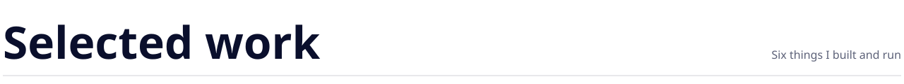
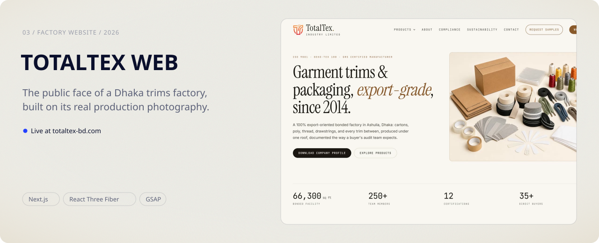
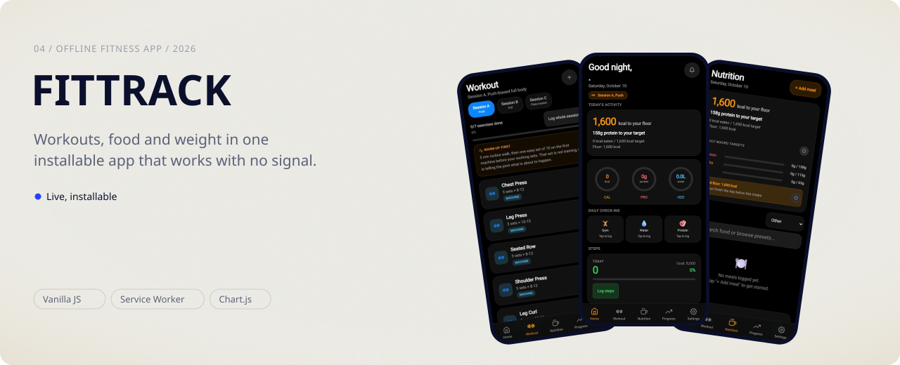
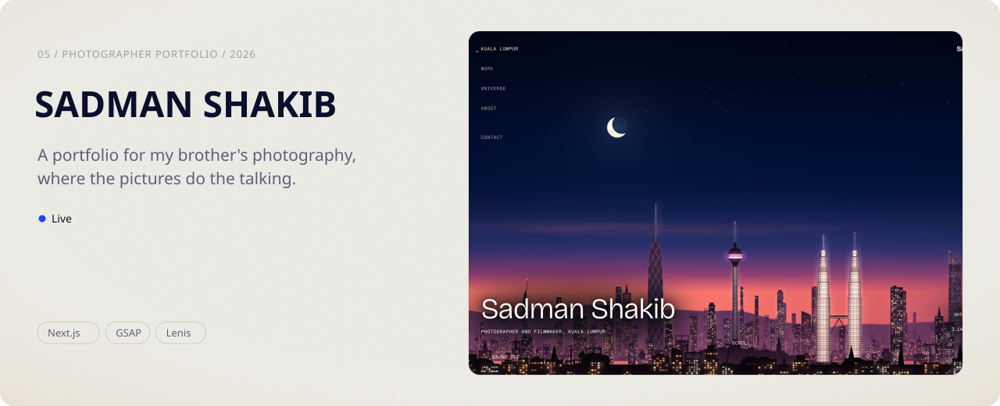
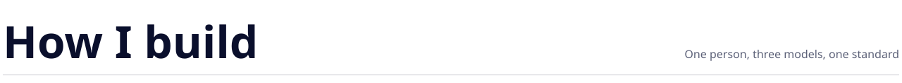

<picture><source media="(prefers-color-scheme: dark)" srcset="assets/header-night.svg"><source media="(prefers-color-scheme: light)" srcset="assets/header-day.svg"></picture>

I'm Adnan Shakib, a computer science student at the University of Calgary (April 2028). I co-run Puzzled, a dealership operation in Calgary, and I'm taking over TotalTex, my family's garment trims factory in Dhaka. I write the software both of them run on. Open to summer 2027 internships.

<picture><source media="(prefers-color-scheme: dark)" srcset="assets/title-work-night.svg"><source media="(prefers-color-scheme: light)" srcset="assets/title-work-day.svg"></picture>

<picture><source media="(prefers-color-scheme: dark)" srcset="assets/card-puzzled-night.svg"><source media="(prefers-color-scheme: light)" srcset="assets/card-puzzled-day.svg"></picture>

<picture><source media="(prefers-color-scheme: dark)" srcset="assets/card-totaltex-ops-night.svg"><source media="(prefers-color-scheme: light)" srcset="assets/card-totaltex-ops-day.svg"></picture>

<a href="https://totaltex-bd.com"><picture><source media="(prefers-color-scheme: dark)" srcset="assets/card-totaltex-web-night.svg"><source media="(prefers-color-scheme: light)" srcset="assets/card-totaltex-web-day.svg"></picture></a>

<a href="https://addyrallxx.github.io/fittrack/fittrack.html"><picture><source media="(prefers-color-scheme: dark)" srcset="assets/card-fittrack-night.svg"><source media="(prefers-color-scheme: light)" srcset="assets/card-fittrack-day.svg"></picture></a>

<a href="https://sadman-shakib.vercel.app"><picture><source media="(prefers-color-scheme: dark)" srcset="assets/card-sadman-night.svg"><source media="(prefers-color-scheme: light)" srcset="assets/card-sadman-day.svg"></picture></a>

<a href="https://github.com/addyrallxx/studio"><picture><source media="(prefers-color-scheme: dark)" srcset="assets/card-studio-night.svg"><source media="(prefers-color-scheme: light)" srcset="assets/card-studio-day.svg"></picture></a>

Two of these are private because they run real businesses on real client data. The cards show what they do; the code stays where it is.

<picture><source media="(prefers-color-scheme: dark)" srcset="assets/title-studio-night.svg"><source media="(prefers-color-scheme: light)" srcset="assets/title-studio-day.svg"></picture>

I plan and own the taste. Claude, Codex and Gemini build in parallel, each on its own files, and a different model reviews every diff before I re-run the result myself. The tooling is open in [studio](https://github.com/addyrallxx/studio).

[Portfolio](https://addyrallxx-site.vercel.app) · [LinkedIn](https://www.linkedin.com/in/adnanshakib/) · [Email](mailto:adnanshakib.business@gmail.com)
